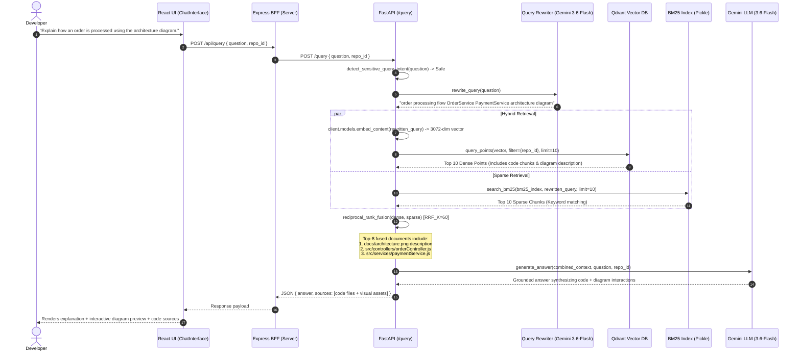

# Codebase Copilot: Multimodal RAG System Architecture

> **Architecture Specification & Design Documentation**  
> **Repository:** `samik930/github_codebase_ai` (Codebase Copilot)  
> **Target:** Multimodal RAG Extension for Software Engineering Repositories

---

## 1. Executive Summary & Existing Architecture Baseline

Codebase Copilot is a specialized codebase question-answering and search platform built using a three-tier architecture:
1. **Presentation Layer:** React 18 SPA built with Vite (`client/`).
2. **Backend for Frontend (BFF):** Node.js + Express server running on port `5000` (`server/`).
3. **RAG Microservice:** Python FastAPI service running on port `8000` (`RAG/`).

```
┌────────────────────────────────────────────────────────────────────────┐
│                        EXISTING STACK SUMMARY                          │
├──────────────────────┬─────────────────────────────────────────────────┤
│ Frontend             │ React 18 + Vite (client/src/)                   │
│ Backend For Frontend │ Node.js + Express (server/src/, port 5000)      │
│ RAG Microservice     │ Python FastAPI (RAG/, port 8000)                │
│ Embedding Model      │ gemini-embedding-2 (3072 dimensions)            │
│ LLM & Vision Model   │ gemini-3.6-flash (generation, rewriting, guard)  │
│ Vector Database      │ Qdrant Cloud (collection: codebase_documents)   │
│ Keyword Search       │ BM25Okapi (per-repository pickle files in data/)│
│ Fusion Algorithm     │ Reciprocal Rank Fusion (RRF, k=60)              │
└──────────────────────┴─────────────────────────────────────────────────┘
```

### Existing Codebase File & Function Mapping

- **Client (`client/src/components/`)**:
  - `IngestCard.jsx`: Captures GitHub URL, initiates SSE stream to `/api/ingest`.
  - `ChatInterface.jsx`: Query input, message history, markdown rendering with `react-markdown` and `remark-gfm`.
  - `SourceViewer.jsx`: Referenced file viewer displaying path, language, and similarity telemetry.
  - `RepoStats.jsx`: Indexed repository selector and stats via `/api/repositories`.
- **Server BFF (`server/src/`)**:
  - `index.js`: Express server (port 5000), CORS middleware, `/api` route mounting.
  - `routes/routes.js`: Maps `/api/ingest`, `/api/query`, `/api/repositories`.
  - `controllers/controller.js`:
    - `ingestController()`: Fetches repo metadata, streams SSE progress, dispatches to FastAPI.
    - `queryController()`: Dispatches queries with `repo_id` to FastAPI.
    - `repositoriesController()`: Fetches list of indexed repositories from FastAPI.
  - `github/downloadRepo.js`: GitHub Octokit/Axios integration. Filters file types via `isUsefulFile()`.
- **RAG Microservice (`RAG/`)**:
  - `app.py`: FastAPI endpoints (`/ingest`, `/query`, `/repositories`).
  - `ingest.py`: `RecursiveCharacterTextSplitter(chunk_size=500, chunk_overlap=50)`, `gemini-embedding-2` (3072-dim), Qdrant upserts (`codebase_documents`), BM25 index creation.
  - `bm25.py`: `BM25Okapi` indexing and query scoring (`search_bm25`).
  - `retrieve.py`: `rewrite_query()`, `extract_metadata()`, dense Qdrant search (limit=10), sparse BM25 search (limit=10), `reciprocal_rank_fusion(dense, sparse)` with $k=60$.
  - `generate.py`: Context compilation with boundary enforcement and credential protection; answer generation via `gemini-3.6-flash`.
  - `sensitive_guard.py`: Intent detection, secret file detection, and credential redacting.

---

## 2. Complete Multimodal RAG System Architecture Diagram

```mermaid
flowchart TB
    %% =========================================================================
    %% LAYER 1: PRESENTATION LAYER
    %% =========================================================================
    subgraph L1 ["<b>1. Presentation Layer (React + Vite Client)</b>"]
        direction TB
        UI_RepoInput["GitHub Repo URL Input<br/><i>IngestCard.jsx</i>"]
        UI_Chat["Question Answering Interface<br/><i>ChatInterface.jsx</i>"]
        UI_ImageUpload["<b>[NEW]</b> Optional Image Upload / Dropzone<br/><i>Architecture Diagram / Screenshot</i>"]
        UI_Display["Multimodal Response & Diagram Viewer<br/><i>SourceViewer.jsx (Code + Visual Asset Tabs)</i>"]
    end

    %% =========================================================================
    %% LAYER 2: BACKEND LAYER (BFF)
    %% =========================================================================
    subgraph L2 ["<b>2. Backend Layer (Node.js + Express BFF - Port 5000)</b>"]
        direction TB
        EXP_Router["Express Router<br/><i>server/src/routes/routes.js</i>"]
        EXP_IngestCtrl["Ingestion Controller<br/><i>ingestController() in controller.js</i>"]
        EXP_QueryCtrl["Query Controller & Multimodal Dispatch<br/><i>queryController() in controller.js</i>"]
        EXP_SSE["SSE Progress Streamer<br/><i>text/event-stream relay</i>"]
    end

    %% =========================================================================
    %% LAYER 3: REPOSITORY INGESTION LAYER
    %% =========================================================================
    subgraph L3 ["<b>3. Repository Ingestion Layer (GitHub Integration)</b>"]
        direction TB
        GH_Fetch["GitHub API Client<br/><i>downloadRepo.js (getRepositoryTree)</i>"]
        GH_Router{"Asset Classifier & Filter<br/><i>isUsefulFile() router</i>"}
        GH_CodeFiles["Source Code & Markdown Docs<br/><i>.js, .py, .go, .java, .md, .json</i>"]
        GH_VisualAssets["<b>[NEW]</b> Visual Asset Extractor<br/><i>.png, .jpg, .jpeg, .webp, .svg</i>"]
    end

    %% =========================================================================
    %% LAYER 4: TEXT PROCESSING PIPELINE
    %% =========================================================================
    subgraph L4 ["<b>4. Text Processing Pipeline (FastAPI / RAG)</b>"]
        direction TB
        TXT_Guard["Sensitive Content Redactor<br/><i>sensitive_guard.py</i>"]
        TXT_Splitter["Recursive Character Text Splitter<br/><i>chunk_size=500, overlap=50 (ingest.py)</i>"]
        TXT_Embed["Text Embedding Generator<br/><i>gemini-embedding-2 (3072-dim)</i>"]
    end

    %% =========================================================================
    %% LAYER 5: VISUAL PROCESSING PIPELINE
    %% =========================================================================
    subgraph L5 ["<b>5. Visual Processing Pipeline (FastAPI - Vision Extractor)</b>"]
        direction TB
        VIS_Detect["Visual Asset Preprocessor<br/><i>MIME detector & Base64 encoder</i>"]
        VIS_Gemini["<b>[NEW]</b> Gemini Vision Analysis<br/><i>gemini-3.6-flash (Vision mode)</i>"]
        VIS_Extractor["Visual Structural Synthesizer<br/><i>Extracts components, services, flows, labels</i>"]
        VIS_SearchableDoc["Searchable Visual Representation<br/><i>Markdown Summary + Raw Image GitHub URL + Metadata</i>"]
        VIS_Embed["Visual Description Embedder<br/><i>gemini-embedding-2 (3072-dim)</i>"]
    end

    %% =========================================================================
    %% LAYER 6: STORAGE AND INDEXING LAYER
    %% =========================================================================
    subgraph L6 ["<b>6. Storage and Indexing Layer</b>"]
        direction TB
        QDRANT[("<b>Qdrant Cloud Vector Database</b><br/>Collection: codebase_documents<br/>Vector Size: 3072 | Cosine<br/>Payload: page_content, repo_id, path, type")]
        BM25_STORE[("<b>Per-Repo BM25 Index Store</b><br/>data/bm25-{repo_id}.pkl<br/>Indexed: Code tokens + Visual description tokens")]
        IMG_CACHE[("<b>Visual Asset Metadata & URL Registry</b><br/>Raw GitHub Content URLs / Base64 cache")]
    end

    %% =========================================================================
    %% LAYER 7: HYBRID RETRIEVAL LAYER
    %% =========================================================================
    subgraph L7 ["<b>7. Hybrid Retrieval Layer (RAG/retrieve.py)</b>"]
        direction TB
        RET_Guard["Sensitive Query Intent Guard<br/><i>detect_sensitive_query_intent()</i>"]
        RET_Rewriter["Query Rewriter & Metadata Extractor<br/><i>gemini-3.6-flash (query_rewriter.py)</i>"]
        RET_Dense["Dense Vector Search (Qdrant)<br/><i>qdrant.query_points (limit=10, repo_id filter)</i>"]
        RET_Sparse["Sparse Keyword Search (BM25)<br/><i>search_bm25() (limit=10)</i>"]
        RET_RRF["Reciprocal Rank Fusion (RRF)<br/><i>Score = Σ 1 / (60 + rank)</i>"]
        RET_TopK["Top-K Context Assembler (K=8)<br/><i>Code Chunks + Diagram Descriptions</i>"]
    end

    %% =========================================================================
    %% LAYER 8: GENERATION LAYER
    %% =========================================================================
    subgraph L8 ["<b>8. Generation Layer (RAG/generate.py)</b>"]
        direction TB
        GEN_ContextBuilder["Unified Context Constructor<br/><i>Code Context + Diagram Semantic Evidence + Image Links</i>"]
        GEN_LLM["Google Gemini LLM<br/><i>gemini-3.6-flash (temperature=0.0)</i>"]
        GEN_Sanitizer["Output Sanitizer & Link Resolver<br/><i>redact_sensitive_content() + image markdown citations</i>"]
    end

    %% =========================================================================
    %% FLOW ARROWS: INGESTION WORKFLOW
    %% =========================================================================
    UI_RepoInput -->|"1. Submit GitHub URL"| EXP_Router
    EXP_Router -->|"Route to ingest"| EXP_IngestCtrl
    EXP_IngestCtrl -->|"2. Fetch Tree & Blobs"| GH_Fetch
    GH_Fetch --> GH_Router

    %% Text Branch
    GH_Router -->|"Code & Docs (.js, .py, .md)"| GH_CodeFiles
    GH_CodeFiles -->|"Raw File Contents"| TXT_Guard
    TXT_Guard -->|"Sanitized text"| TXT_Splitter
    TXT_Splitter -->|"Chunks (chunk_size=500)"| TXT_Embed
    TXT_Splitter -.->|"Chunk tokens"| BM25_STORE
    TXT_Embed -->|"3072-dim vectors (type: code)"| QDRANT

    %% Visual Branch (NEW)
    GH_Router -->|"Images (.png, .jpg, .svg, .webp)"| GH_VisualAssets
    GH_VisualAssets -->|"Raw Image Blobs + Path"| VIS_Detect
    VIS_Detect -->|"Base64 Image Payload"| VIS_Gemini
    VIS_Gemini -->|"Prompt: Extract flows, boxes, labels"| VIS_Extractor
    VIS_Extractor -->|"Structured description + raw image URL"| VIS_SearchableDoc
    VIS_SearchableDoc -->|"Store image link & path"| IMG_CACHE
    VIS_SearchableDoc -.->|"Description tokens"| BM25_STORE
    VIS_SearchableDoc -->|"Pass description text"| VIS_Embed
    VIS_Embed -->|"3072-dim vectors (type: visual_asset)"| QDRANT

    %% SSE Feedback
    EXP_IngestCtrl -.->|"SSE Stream Updates"| EXP_SSE
    EXP_SSE -.->|"Real-time Progress (0-100%)"| UI_RepoInput

    %% =========================================================================
    %% FLOW ARROWS: QUERY & RETRIEVAL WORKFLOW
    %% =========================================================================
    UI_Chat -->|"1. Ask question + repo_id"| EXP_Router
    UI_ImageUpload -.->|"Optional: Direct user diagram"| EXP_Router
    EXP_Router -->|"Route to query"| EXP_QueryCtrl
    EXP_QueryCtrl -->|"2. POST /query"| RET_Guard

    RET_Guard -->|"Safe query validated"| RET_Rewriter
    RET_Rewriter -->|"Query Embedding (gemini-embedding-2)"| RET_Dense
    RET_Rewriter -->|"Rewritten keyword query"| RET_Sparse

    RET_Dense <-->|"Vector similarity search"| QDRANT
    RET_Sparse <-->|"Keyword scoring"| BM25_STORE

    RET_Dense -->|"Top 10 Dense Points"| RET_RRF
    RET_Sparse -->|"Top 10 Sparse Documents"| RET_RRF

    RET_RRF -->|"Fused & Re-ranked Documents"| RET_TopK
    RET_TopK -->|"Combined Code + Visual Evidence"| GEN_ContextBuilder
    IMG_CACHE -.->|"Fetch original image URL by path"| GEN_ContextBuilder

    GEN_ContextBuilder -->|"Grounding Context + Repo Boundary Prompt"| GEN_LLM
    GEN_LLM -->|"Generated Explanation"| GEN_Sanitizer
    GEN_Sanitizer -->|"JSON { answer, sources, visual_assets }"| EXP_QueryCtrl
    EXP_QueryCtrl -->|"Response Payload"| UI_Display

    %% =========================================================================
    %% STYLING & CLASSES
    %% =========================================================================
    classDef clientLayer fill:#1e1e2e,stroke:#89b4fa,stroke-width:2px,color:#cdd6f4;
    classDef bffLayer fill:#181825,stroke:#f9e2af,stroke-width:2px,color:#cdd6f4;
    classDef repoLayer fill:#11111b,stroke:#a6e3a1,stroke-width:2px,color:#cdd6f4;
    classDef textLayer fill:#181825,stroke:#94e2d5,stroke-width:2px,color:#cdd6f4;
    classDef visualLayer fill:#313244,stroke:#cba6f7,stroke-width:3px,color:#f5c2e7;
    classDef storageLayer fill:#1e1e2e,stroke:#fab387,stroke-width:2px,color:#cdd6f4;
    classDef retrievalLayer fill:#181825,stroke:#74c7ec,stroke-width:2px,color:#cdd6f4;
    classDef genLayer fill:#1e1e2e,stroke:#f38ba8,stroke-width:2px,color:#cdd6f4;

    class UI_RepoInput,UI_Chat,UI_ImageUpload,UI_Display clientLayer;
    class EXP_Router,EXP_IngestCtrl,EXP_QueryCtrl,EXP_SSE bffLayer;
    class GH_Fetch,GH_Router,GH_CodeFiles,GH_VisualAssets repoLayer;
    class TXT_Guard,TXT_Splitter,TXT_Embed textLayer;
    class VIS_Detect,VIS_Gemini,VIS_Extractor,VIS_SearchableDoc,VIS_Embed visualLayer;
    class QDRANT,BM25_STORE,IMG_CACHE storageLayer;
    class RET_Guard,RET_Rewriter,RET_Dense,RET_Sparse,RET_RRF,RET_TopK retrievalLayer;
    class GEN_ContextBuilder,GEN_LLM,GEN_Sanitizer genLayer;
```



---

## 3. Sequence Workflows

### A. Multimodal Repository Ingestion Workflow

```mermaid
sequenceDiagram
    autonumber
    actor Dev as Developer
    participant UI as React UI (IngestCard)
    participant Express as Express BFF (Server)
    participant GH as GitHub API
    participant Fast as FastAPI Microservice
    participant GemVision as Gemini Vision (3.6-Flash)
    participant GemEmb as Gemini Embedding-2
    participant Qdrant as Qdrant Vector DB
    participant BM25 as BM25 File Store

    Dev->>UI: Enters GitHub URL & clicks Ingest
    UI->>Express: POST /api/ingest { githubUrl }
    Express->>GH: getRepositoryTree(owner, repo, branch)
    GH-->>Express: Complete File Tree & Commit SHA

    rect rgb(30, 45, 60)
        Note over Express,GH: Asset Partitioning
        Express->>GH: Fetch Code & Docs (.js, .py, .md)
        Express->>GH: Fetch Images (.png, .jpg, .webp, .svg) as Base64
    end

    Express->>Fast: POST /ingest { files: [code + visualAssets], repo_id, commit_hash }
    Fast->>UI: SSE Event: status ("Splitting text & analyzing visual assets...")

    par Visual Pipeline
        Fast->>GemVision: Analyze image base64 + technical prompt
        GemVision-->>Fast: Structured diagram description (components, arrows, flows)
        Fast->>GemEmb: Embed visual description (3072-dim)
        GemEmb-->>Fast: Visual vector
    and Code Pipeline
        Fast->>Fast: Split code into 500-char chunks (overlap=50)
        Fast->>GemEmb: embed_batch(chunks)
        GemEmb-->>Fast: Code vectors
    end

    Fast->>BM25: Build & save BM25 index (code chunks + visual descriptions)
    Fast->>Qdrant: Upsert code points & visual asset points (with metadata.type)
    Fast-->>Express: SSE Event: complete { repository, chunks, files }
    Express-->>UI: SSE Complete Event
    UI-->>Dev: Ingestion Complete Notification & Repo Stats Updated
```



---

### B. Multimodal Question-Answering Workflow



---

## 4. Layer-by-Layer Architectural Details

### 1. Presentation Layer (`client/`)
- **Framework:** React 18 with Vite.
- **Components:**
  - `IngestCard.jsx`: Submits GitHub repository URLs, listens to SSE updates for chunking, embedding, and visual processing phases.
  - `ChatInterface.jsx`: Chat history, streaming state, quick suggestions. Extended with a file upload button allowing developers to drag and drop arbitrary architecture diagrams/screenshots.
  - `SourceViewer.jsx`: Extended to display a tabbed list of referenced code files and visual assets. For visual assets, renders an interactive thumbnail preview referencing GitHub's raw content URL (`https://raw.githubusercontent.com/{owner}/{repo}/{branch}/{path}`).

### 2. Backend Layer / BFF (`server/`)
- **Runtime:** Node.js with Express (Port 5000).
- **Controllers & Routing:**
  - `server/src/routes/routes.js`: Maps client endpoints (`/api/ingest`, `/api/query`, `/api/repositories`).
  - `server/src/controllers/controller.js`:
    - `ingestController()`: Orchestrates GitHub API fetching, coordinates SSE progress relay to frontend, and dispatches data to FastAPI.
    - `queryController()`: Proxies queries and optional user diagram attachments to FastAPI.

### 3. Repository Ingestion Layer (`server/src/github/`)
- **Module:** `downloadRepo.js`.
- **Logic:**
  - Calls `https://api.github.com/repos/{owner}/{repo}/git/trees/{branch}?recursive=1`.
  - Extends `isUsefulFile()` to recognize visual extensions: `.png`, `.jpg`, `.jpeg`, `.webp`, `.svg`.
  - Fetches visual assets as Base64 payloads and assigns them the deterministic raw URL:
    $$\text{rawUrl} = \text{`https://raw.githubusercontent.com/\$\{owner\}/\$\{repo\}/\$\{branch\}/\$\{filePath\}`}$$

### 4. Text Processing Pipeline (`RAG/ingest.py`)
- **Language Aware Splitting:** Uses LangChain's `RecursiveCharacterTextSplitter(chunk_size=500, chunk_overlap=50)`.
- **Embedding:** `gemini-embedding-2` producing 3072-dimensional vectors.
- **Batch Processing:** Multi-threaded batching using `concurrent.futures.ThreadPoolExecutor(max_workers=5)` with exponential retry handling.

### 5. Visual Processing Pipeline (`RAG/visual_pipeline.py`)
- **Vision Model:** Google Gemini `gemini-3.6-flash` in vision mode.
- **Prompt Specification:** Instructs Gemini to extract:
  1. Identified services, databases, queues, clients, and interfaces.
  2. Directional arrows, request/response protocols (HTTP, gRPC, WebSocket, Kafka).
  3. All diagram text labels, ports, parameters, and notes.
- **Representation:** Synthesizes a structured markdown document containing the semantic description, file path, and raw GitHub image URL.
- **Vectorization:** The generated description is embedded via `gemini-embedding-2` (3072 dimensions), rendering it completely interoperable with text code vectors.

### 6. Storage and Indexing Layer
- **Qdrant Vector Database:**
  - Collection: `codebase_documents`.
  - Vector Size: 3072, Distance Metric: Cosine.
  - Multi-tenancy & Isolation: Point payloads include `metadata.repo_id`, `metadata.path`, `metadata.source`, `metadata.commit_hash`, and `metadata.type` (`"code"` or `"visual_asset"`).
  - Filter Indexes: Created on `metadata.repo_id` to guarantee zero cross-repository leakage.
- **BM25 File Store:**
  - Serialized index files: `RAG/data/bm25-{sanitized_repo_id}.pkl`.
  - Indexes both code tokens and visual description tokens (e.g., service names, queue topics, protocol labels).

### 7. Hybrid Retrieval Layer (`RAG/retrieve.py`)
- **Query Optimization:**
  - `sensitive_guard.py`: Detects and blocks malicious queries seeking credentials, keys, or tokens.
  - `query_rewriter.py`: Uses `gemini-3.6-flash` to expand queries into technical concepts.
  - `extract_metadata()`: Extracts explicit file/path/language constraints from user queries.
- **Retrieval & Fusion:**
  - Dense Search: Qdrant `query_points(limit=10)` filtered by `repo_id`.
  - Sparse Search: BM25 `search_bm25(limit=10)`.
  - Reciprocal Rank Fusion:
    $$\text{RRF Score}(d) = \sum_{m \in \{\text{dense}, \text{sparse}\}} \frac{1}{60 + \text{rank}_m(d)}$$
  - Cutoff: Returns top $K=8$ combined documents.

### 8. Generation Layer (`RAG/generate.py`)
- **Unified Context Construction:** Combines retrieved code blocks and visual diagram descriptions into a structured prompt with strict boundary enforcement.
- **LLM:** `gemini-3.6-flash` running at `temperature=0.0`.
- **Output:** Validated and sanitized JSON `{ "answer": string, "sources": [...] }` containing code file paths and visual asset preview references.

---

## 5. Architectural Comparison: Existing vs. Proposed Multimodal RAG

| Component / Layer | Existing Architecture | Multimodal Architecture Extension |
|---|---|---|
| **React Frontend** | Text-only query input; shows text markdown and code source badges in `SourceViewer.jsx`. | Adds visual asset viewer (inline diagram previews with zoom/pan modals); adds optional diagram image upload dropzone in `ChatInterface.jsx`. |
| **Node.js Express BFF** | Filters out `.png`, `.jpg`, `.jpeg`, `.svg` in `downloadRepo.js`. Forwards only code text to FastAPI. | Detects visual assets; downloads images as base64 blobs; attaches raw GitHub content URLs; routes visual assets to FastAPI ingestion. |
| **FastAPI Microservice** | `ingest.py` only accepts text documents and chunks them with `RecursiveCharacterTextSplitter`. | Introduces `visual_pipeline.py`; handles image inputs, invokes Gemini Vision for diagram understanding, creates searchable visual representations. |
| **Google Gemini Integration** | `gemini-3.6-flash` for query rewriting, metadata extraction, and text answer generation; `gemini-embedding-2` (3072-dim) for text chunks. | `gemini-3.6-flash` also acts as Vision Extractor during ingestion (analyzing UML, flowcharts, architectures); `gemini-embedding-2` embeds extracted visual descriptions into 3072-dim vectors. |
| **Qdrant Vector Database** | Single collection `codebase_documents` containing vector size 3072 of code/doc chunks. | Same collection `codebase_documents` (size 3072); stores both code and visual description vectors. Visual points include `metadata.type = "visual_asset"` and `metadata.raw_url`. |
| **BM25 Keyword Search** | Indexes only tokenized source code and documentation chunks in `data/bm25-{repo_id}.pkl`. | Indexes code chunks **and** tokenized visual description text (service names, arrow labels, queue names), allowing direct keyword matching against diagrams. |
| **Hybrid Retrieval & RRF** | RRF ($k=60$) merges dense and sparse results over code text. | RRF ($k=60$) seamlessly ranks both code chunks and visual descriptions into a single top-K list ($K=8$) without needing separate retrieval silos. |
| **Answer Generation** | Injects only text code snippets into prompt context in `generate.py`. | Injects unified context containing code snippets and diagram structural descriptions, enabling Gemini to correlate code implementations with architectural diagrams. |

---

## 6. End-to-End Real-World Scenario Walkthrough

### Question: *"Explain how an order is processed using the architecture diagram."*

```
                             USER QUERY
         "Explain how an order is processed using the architecture diagram"
                                 │
                 ┌───────────────┴───────────────┐
                 ▼                               ▼
      BM25 Sparse Retrieval           Qdrant Dense Retrieval
   - Matches: "order", "diagram"   - Matches: embedding of order flow
   - Top hit: docs/arch.png (desc) - Top hit: docs/arch.png (vector)
   - Hit: orderController.js       - Hit: paymentService.js
                 └───────────────┬───────────────┘
                                 │
                                 ▼
                     Reciprocal Rank Fusion (RRF)
                 ┌───────────────────────────────┐
                 │ Rank 1: docs/arch.png (Desc)  │
                 │ Rank 2: orderController.js    │
                 │ Rank 3: paymentService.js     │
                 │ Rank 4: events/orderEvent.js  │
                 └───────────────┬───────────────┘
                                 │
                                 ▼
                    Combined Context to Gemini
        [Visual Evidence: docs/arch.png] + [Code Files: orderController.js]
                                 │
                                 ▼
                          Final Response
   1. Explains flow according to diagram (Client -> Gateway -> Order Service -> Kafka -> Payment).
   2. Verifies implementation details with exact code lines and function names.
   3. Displays interactive preview of docs/arch.png alongside referenced source code.
```

### Trace:
1. **User Query:** Developer asks *"Explain how an order is processed using the architecture diagram"* for repository `my-org/ecommerce-core`.
2. **Rewriting:** Gemini expands query to *"order processing lifecycle architecture diagram OrderService PaymentService Kafka event flow"*.
3. **Retrieval:**
   - Qdrant finds high semantic similarity with the vector of `docs/architecture.png` (which was described by Gemini Vision as showing client $\rightarrow$ gateway $\rightarrow$ order service $\rightarrow$ Kafka).
   - BM25 matches keywords `"order"`, `"architecture"`, and `"diagram"` across the tokenized visual description and `orderController.js`.
4. **Fusion:** RRF fuses both lists; the top 8 context items contain both `docs/architecture.png` and primary implementation code files (`orderController.js`, `paymentService.js`).
5. **Generation:** `gemini-3.6-flash` correlates the visual components from the diagram with the actual implementation functions, citing both the diagram image and the relevant source files.
6. **Display:** The React UI renders the grounded markdown answer and displays an interactive preview of `docs/architecture.png` alongside referenced code sources.
