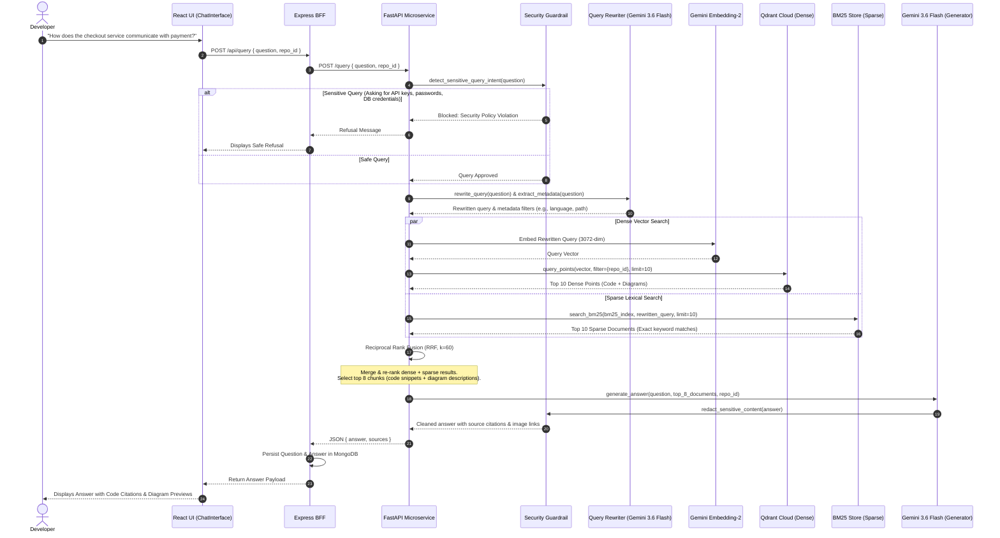
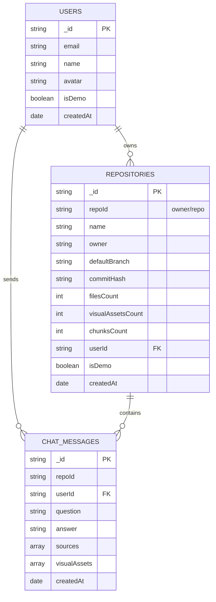

# Codebase Copilot: Multimodal RAG System Architecture

> **Architecture Specification & Systems Design Documentation**  
> **Repository:** `samik930/github_codebase_ai` (Codebase Copilot)  
> **Target:** Multimodal Retrieval-Augmented Generation (RAG) for Software Engineering Repositories

---

## 1. Executive Summary & Problem Statement

### The Problem
Traditional developer tools and code-search systems operate in silos:
- **Code without architectural context** makes it difficult to understand high-level system flows, distributed microservice boundaries, or database relationships.
- **Architecture diagrams and documentation without connected code** quickly become stale and abstract, leaving developers guessing how designs are actually implemented.
- **Traditional RAG systems** only ingest text files (`.js`, `.py`, `.md`). They ignore visual assets (`.png`, `.jpg`, `.svg`, `.webp`), discarding critical system knowledge captured in architecture diagrams, database schemas, and sequence charts.

### The Solution: Codebase Copilot
**Codebase Copilot** is a **Multimodal Retrieval-Augmented Generation (RAG)** platform designed specifically for software codebases. It ingests public GitHub repositories, analyzes both source code and architectural diagrams, and allows developers to ask complex system-level and code-level questions with grounded citations.

```
┌────────────────────────────────────────────────────────────────────────┐
│                        SYSTEM STACK SUMMARY                            │
├──────────────────────┬─────────────────────────────────────────────────┤
│ Presentation Layer   │ React 18 + Vite SPA (client/, port 5173)        │
│ Backend for Frontend │ Node.js + Express (server/, port 5000)          │
│ RAG Microservice     │ Python FastAPI (RAG/, port 8000)                │
│ Primary Database     │ MongoDB (user accounts, repos, chat histories)  │
│ Dense Vector DB      │ Qdrant Cloud (collection: codebase_documents)   │
│ Sparse Lexical DB    │ BM25Okapi (per-repository serialized indexes)   │
│ Text Embedding Model │ gemini-embedding-2 (3072-dimensional vectors)   │
│ LLM & Vision Model   │ gemini-3.6-flash (generation, vision, rewriter) │
│ Rank Fusion Engine   │ Reciprocal Rank Fusion (RRF, k=60)              │
└──────────────────────┴─────────────────────────────────────────────────┘
```

---

## 2. Core Architectural Principles & Mental Model

To understand Codebase Copilot, consider these four core design principles:

### A. The 3-Tier Separation of Concerns
The platform uses three distinct tiers, each optimized for its specific workload:
1. **Client (React SPA):** Provides an interactive UI with real-time progress indicators via Server-Sent Events (SSE), markdown rendering with syntax highlighting, and an interactive source and visual asset viewer.
2. **Backend for Frontend (Node.js/Express BFF):** Manages user authentication (Google OAuth), user sessions, MongoDB persistence for chat histories and repository metadata, and GitHub API interactions.
3. **RAG Microservice (Python FastAPI):** Dedicated to compute-heavy AI operations, including file chunking, Gemini Vision asset analysis, embedding generation, Qdrant vector search, BM25 indexing, and answer generation.

### B. Multimodal Grounding (Vision + Code)
Rather than treating images as raw binary data or relying on generic CLIP embeddings (which struggle with technical text and directional arrows), Codebase Copilot uses a **Vision-to-Semantic-Knowledge pipeline**:
- When an architecture diagram (`.png`, `.jpg`, `.svg`, etc.) is ingested, **Gemini 3.6 Flash** analyzes it with a specialized systems architect prompt.
- It extracts identified components, microservices, databases, queues, communication protocols (HTTP, gRPC, Kafka), and exact code labels.
- This structured description is stored with the original image's GitHub raw URL and embedded into the **same 3072-dimensional vector space** as the source code.
- Consequently, code files and architectural diagrams can be retrieved together in a single search pass.

### C. Hybrid Search (Dense Vector + Sparse Lexical + RRF)
Codebases require two complementary search strategies:
- **Dense Vector Search (Qdrant):** Captures conceptual and semantic intent (e.g., *"How do we handle user authentication?"* finds token middleware even if the word "authentication" is never explicitly written).
- **Sparse Lexical Search (BM25):** Excels at exact technical keyword matching (e.g., exact class names like `AuthTokenValidator`, endpoint routes like `/api/v1/orders`, or specific variable names).
- **Reciprocal Rank Fusion (RRF):** Merges the results of both search methods without needing arbitrary score normalization.

### D. Strict Repository Isolation (Multi-Tenancy)
To prevent cross-repository data leakage:
- Every point in **Qdrant** is tagged with `metadata.repo_id`, and all vector searches enforce a mandatory filter on `repo_id`.
- Every repository maintains its own isolated **BM25 index file** on disk (`data/bm25-{repo_id}.pkl`).
- All generation prompts enforce a strict repository boundary instruction.

---

## 3. High-Level Architecture Blueprint

The following diagram illustrates how all components connect across the three tiers:

```mermaid
flowchart TB
    %% =========================================================================
    %% TIER 1: PRESENTATION LAYER
    %% =========================================================================
    subgraph T1 ["<b>1. Presentation Layer (React 18 + Vite Client - Port 5173)</b>"]
        direction TB
        UI_RepoInput["<b>Ingest Card</b><br/><i>IngestCard.jsx</i><br/>GitHub URL input & SSE progress bar"]
        UI_Chat["<b>Chat Interface</b><br/><i>ChatInterface.jsx</i><br/>Question input, chat history, markdown"]
        UI_Display["<b>Source & Asset Viewer</b><br/><i>SourceViewer.jsx</i><br/>Code snippets & interactive diagram previews"]
    end

    %% =========================================================================
    %% TIER 2: BACKEND FOR FRONTEND (BFF)
    %% =========================================================================
    subgraph T2 ["<b>2. Backend for Frontend (Node.js + Express - Port 5000)</b>"]
        direction TB
        BFF_Router["<b>Express Router</b><br/><i>routes/routes.js</i><br/>/api/ingest, /api/query, /api/chat"]
        BFF_Ctrl["<b>API Controllers</b><br/><i>controllers/controller.js</i><br/>Request validation & SSE relay"]
        BFF_GH["<b>GitHub Service</b><br/><i>github/downloadRepo.js</i><br/>Fetches tree, filters code & images"]
        BFF_DB[("<b>MongoDB Database</b><br/>Stores Users, Repositories,<br/>and Chat Histories")]
    end

    %% =========================================================================
    %% TIER 3: RAG MICROSERVICE
    %% =========================================================================
    subgraph T3 ["<b>3. RAG Microservice (Python FastAPI - Port 8000)</b>"]
        direction TB
        API_Fast["<b>FastAPI Router</b><br/><i>app.py</i><br/>POST /ingest, POST /query"]
        Guard["<b>Security Guardrail</b><br/><i>sensitive_guard.py</i><br/>Secret redaction & prompt protection"]
        Rewriter["<b>Query Rewriter</b><br/><i>query_rewriter.py</i><br/>Query expansion & metadata filter extraction"]
        Splitter["<b>Text Chunking</b><br/><i>ingest.py</i><br/>RecursiveCharacterTextSplitter (500/50)"]
        Vision["<b>Visual Pipeline</b><br/><i>visual_pipeline.py</i><br/>Gemini Vision architectural analysis"]
        RRF["<b>Hybrid RRF Engine</b><br/><i>retrieve.py</i><br/>Dense + Sparse rank fusion (k=60)"]
        Gen["<b>Answer Generator</b><br/><i>generate.py</i><br/>Boundary prompt & citation builder"]
    end

    %% =========================================================================
    %% STORAGE & MODELS
    %% =========================================================================
    subgraph T4 ["<b>4. AI Models & Storage Layer</b>"]
        direction TB
        QDRANT[("<b>Qdrant Cloud Vector DB</b><br/>Collection: codebase_documents<br/>Vectors: 3072-dim Cosine")]
        BM25_STORE[("<b>BM25 Index Store</b><br/>data/bm25-{repo_id}.pkl<br/>Lexical tokens (code + diagrams)")]
        GEM_EMB["<b>Google Gemini Embeddings</b><br/>gemini-embedding-2 (3072-dim)"]
        GEM_LLM["<b>Google Gemini LLM</b><br/>gemini-3.6-flash (Vision + Text)"]
    end

    %% =========================================================================
    %% INGESTION FLOW CONNECTIONS
    %% =========================================================================
    UI_RepoInput -->|"1. Submit GitHub URL"| BFF_Router
    BFF_Router --> BFF_Ctrl
    BFF_Ctrl -->|"2. Fetch Tree & Blobs"| BFF_GH
    BFF_Ctrl -->|"Store Repo Metadata"| BFF_DB
    BFF_Ctrl -->|"3. Stream POST /ingest"| API_Fast
    API_Fast --> Guard
    Guard --> Splitter
    Guard --> Vision
    Vision -->|"Analyze Diagram"| GEM_LLM
    Vision -->|"Embed Description"| GEM_EMB
    Splitter -->|"Embed Chunks"| GEM_EMB
    GEM_EMB -->|"Upsert Vectors"| QDRANT
    Splitter & Vision -->|"Save Lexical Tokens"| BM25_STORE
    API_Fast -.->|"SSE Progress (0-100%)"| BFF_Ctrl
    BFF_Ctrl -.->|"SSE Progress Relay"| UI_RepoInput

    %% =========================================================================
    %% QUERY FLOW CONNECTIONS
    %% =========================================================================
    UI_Chat -->|"1. Submit Question + repo_id"| BFF_Router
    BFF_Router --> BFF_Ctrl
    BFF_Ctrl -->|"2. POST /query"| API_Fast
    API_Fast --> Guard
    Guard --> Rewriter
    Rewriter -->|"Query Vector"| GEM_EMB
    GEM_EMB -->|"Dense Search (Top 10)"| QDRANT
    Rewriter -->|"Keyword Search (Top 10)"| BM25_STORE
    QDRANT & BM25_STORE --> RRF
    RRF -->|"Top 8 Fused Chunks"| Gen
    Gen -->|"Synthesize Answer"| GEM_LLM
    GEM_LLM --> Guard
    Guard -->|"Answer + Citations"| BFF_Ctrl
    BFF_Ctrl -->|"Save Chat Turn"| BFF_DB
    BFF_Ctrl -->|"Display Answer"| UI_Chat
    BFF_Ctrl -->|"Display Sources & Images"| UI_Display

    %% =========================================================================
    %% STYLES
    %% =========================================================================
    classDef clientStyle fill:#1e1e2e,stroke:#89b4fa,stroke-width:2px,color:#cdd6f4;
    classDef bffStyle fill:#181825,stroke:#f9e2af,stroke-width:2px,color:#cdd6f4;
    classDef ragStyle fill:#11111b,stroke:#a6e3a1,stroke-width:2px,color:#cdd6f4;
    classDef storageStyle fill:#313244,stroke:#cba6f7,stroke-width:2px,color:#f5c2e7;

    class UI_RepoInput,UI_Chat,UI_Display clientStyle;
    class BFF_Router,BFF_Ctrl,BFF_GH,BFF_DB bffStyle;
    class API_Fast,Guard,Rewriter,Splitter,Vision,RRF,Gen ragStyle;
    class QDRANT,BM25_STORE,GEM_EMB,GEM_LLM storageStyle;
```



---

## 4. Deep Dive: Ingestion Lifecycle

The ingestion lifecycle transforms a raw GitHub repository into an indexed, searchable multimodal knowledge base.

```mermaid
sequenceDiagram
    autonumber
    actor Dev as Developer
    participant UI as React UI (IngestCard)
    participant Express as Express BFF
    participant GH as GitHub REST API
    participant Fast as FastAPI Microservice
    participant GemVision as Gemini 3.6 Flash (Vision)
    participant GemEmb as Gemini Embedding-2
    participant Qdrant as Qdrant Cloud
    participant BM25 as Local BM25 Store

    Dev->>UI: Enters GitHub URL & Clicks "Ingest"
    UI->>Express: POST /api/ingest { githubUrl, userId }
    Express->>UI: SSE Connected (text/event-stream)

    Express->>GH: GET /repos/{owner}/{repo}/git/trees/{branch}?recursive=1
    GH-->>Express: Complete File Tree & Latest Commit SHA

    rect rgb(28, 33, 40)
        Note over Express,GH: Asset Partitioning
        Express->>GH: Fetch Code & Markdown Files (.js, .py, .md, .go, etc.)
        Express->>GH: Fetch Visual Assets (.png, .jpg, .webp, .svg) as Base64
    end

    Express->>Fast: POST /ingest { files, visual_files, repo_id, commit_hash }
    Fast-->>Express: SSE status: "Processing multimodal content..."

    par Visual Asset Pipeline
        Fast->>GemVision: Analyze Image Base64 with Systems Architect Prompt
        GemVision-->>Fast: Structured Architectural Markdown (Services, Flows, Labels)
        Fast->>GemEmb: Embed Visual Description (3072-dim)
        GemEmb-->>Fast: Visual Vector
    and Source Code Pipeline
        Fast->>Fast: Text Splitter: 500-char chunks (overlap=50)
        Fast->>GemEmb: Embed Code Chunks in Batches (3072-dim)
        GemEmb-->>Fast: Code Vectors
    end

    Fast->>BM25: Build & Save BM25 Index (Code Tokens + Diagram Tokens)
    Fast->>Qdrant: Upsert Points (Vectors + repo_id + path + raw_url metadata)

    Fast-->>Express: SSE complete: { repository, filesCount, chunksCount }
    Express->>Express: Persist Repository Metadata in MongoDB
    Express-->>UI: SSE Complete Event
    UI-->>Dev: Ingestion Complete! Repository Ready for Querying
```



### Detailed Ingestion Steps

#### 1. Repository Traversal & Filtering (`server/src/github/downloadRepo.js`)
- Uses GitHub's Git Data Trees API to retrieve the repository hierarchy in a single API call.
- Applies **intelligent exclusion rules** to avoid indexing bloat:
  - Excludes `node_modules/`, `vendor/`, `dist/`, `build/`, `.git/`, lockfiles (`package-lock.json`, `yarn.lock`), and binary executables.
- Classifies discovered files into two categories:
  1. **Source Code & Documentation:** `.js`, `.jsx`, `.ts`, `.tsx`, `.py`, `.java`, `.go`, `.rs`, `.cpp`, `.c`, `.cs`, `.php`, `.md`, `.json`, `.yml`, `.yaml`, `.sql`, `Dockerfile`.
  2. **Visual Assets:** `.png`, `.jpg`, `.jpeg`, `.webp`, `.svg`.

#### 2. Visual Pipeline: Architecture Understanding (`RAG/visual_pipeline.py`)
Architecture diagrams cannot be understood by naive text splitters. For each visual asset:
- The base64-encoded image is sent to **Gemini 3.6 Flash** with a specialized prompt requiring:
  1. **Summary:** High-level architectural role.
  2. **Asset Type:** Architecture Diagram, Flowchart, Sequence Diagram, Database ERD, UI Screenshot, or Other.
  3. **Identified Components & Services:** Microservices, gateways, databases, queues (Kafka, RabbitMQ), caches (Redis), third-party services.
  4. **Data Flows & Protocols:** Communication arrows, HTTP/REST, gRPC, WebSocket, GraphQL, AMQP, SQL relationships.
  5. **Technical Labels & Annotations:** Exact port numbers, environment variables, class names, table names.
- The resulting structured description is combined with the asset's GitHub raw URL:
  $$\text{rawUrl} = \text{https://raw.githubusercontent.com/\{owner\}/\{repo\}/\{branch\}/\{filePath\}}$$
- This description is embedded into a 3072-dimensional vector via `gemini-embedding-2`, making the diagram searchable alongside code.

#### 3. Text Chunking & Embedding (`RAG/ingest.py`)
- Source code files are split using `RecursiveCharacterTextSplitter`:
  - `chunk_size = 500` characters.
  - `chunk_overlap = 50` characters.
- Embeddings are generated in parallel batches using `gemini-embedding-2` (3072 dimensions).

#### 4. Dual Indexing
- **Dense Vectors:** Upserted into Qdrant Cloud under collection `codebase_documents`. Every point contains:
  ```json
  {
    "id": "uuid",
    "vector": [0.012, -0.045, ...],
    "payload": {
      "page_content": "chunk text or visual description",
      "metadata": {
        "repo_id": "owner/repo",
        "path": "src/controllers/orderController.js",
        "source": "src/controllers/orderController.js",
        "commit_hash": "a1b2c3d...",
        "type": "code",
        "chunkId": "owner/repo_src/controllers/orderController.js_0"
      }
    }
  }
  ```
  *(For visual assets, `"type": "visual_asset"` and `"raw_url": "https://raw.githubusercontent.com/..."` are included).*
- **Sparse BM25 Index:** Tokenized words from both code chunks and visual descriptions are saved to a repository-specific serialized index at `RAG/data/bm25-{sanitized_repo_id}.pkl`.

---

## 5. Deep Dive: Query & Hybrid Retrieval Lifecycle

When a developer submits a query, Codebase Copilot executes a multi-stage retrieval pipeline before generating an answer.



### Detailed Retrieval Steps

#### 1. Security Intent Guard (`RAG/sensitive_guard.py`)
Before executing any retrieval, the query is inspected for credential-harvesting intent:
- Scans for patterns requesting passwords, private keys, database connection strings, `.env` file dumps, or API tokens.
- If detected, retrieval is immediately bypassed, and a secure refusal message is returned.

#### 2. Query Rewriting & Metadata Extraction (`RAG/query_rewriter.py`, `RAG/retrieve.py`)
Natural language developer queries are often brief or ambiguous:
- **Rewriting:** `gemini-3.6-flash` expands the query into domain-specific terms (e.g., *"How do orders process?"* $\rightarrow$ *"order processing checkout workflow PaymentService Kafka event orderController"*).
- **Metadata Extraction:** If the query mentions specific file extensions (`.py`, `.ts`), directory paths (`server/src/`), or languages, metadata filters are constructed to narrow the search scope.

#### 3. Dual Search Execution
- **Dense Search (Qdrant):** Retrieves the top 10 vector matches strictly matching `metadata.repo_id`.
- **Sparse Search (BM25):** Evaluates keyword frequency against the repository's BM25 index and retrieves the top 10 matches.

#### 4. Reciprocal Rank Fusion (RRF)
To combine dense and sparse results without score calibration discrepancies, Codebase Copilot applies **Reciprocal Rank Fusion**:

$$\text{RRF Score}(d) = \sum_{m \in \{\text{dense}, \text{sparse}\}} \frac{1}{k + \text{rank}_m(d)}$$

Where:
- $k = 60$ (standard smoothing constant).
- $\text{rank}_m(d)$ is the 1-based rank of document $d$ in search system $m$.
- Documents appearing in both dense and sparse lists receive a combined score boost.
- The **top 8 fused documents** are passed to the generation stage.

---

## 6. Deep Dive: Generation & Response Synthesis

### Context Construction (`RAG/generate.py`)
The top 8 retrieved documents are formatted into a unified prompt context. Items are labeled according to their type:

```markdown
--- Architecture Diagram / Visual Asset: docs/architecture.png (Image URL: https://raw.githubusercontent.com/...) ---
### Summary:
E-commerce payment processing architecture showing microservices and queue routing.
### Identified Components:
CheckoutService, PaymentGateway, StripeClient, Kafka order-events topic.
### Data Flows:
CheckoutService sends POST /pay -> PaymentGateway -> publishes to Kafka.

--- Source Code File: src/controllers/checkoutController.js ---
export async function processCheckout(req, res) {
    const { orderId, amount } = req.body;
    await kafkaProducer.send({ topic: 'order-events', message: { orderId, amount } });
}
```

### Prompt Guardrails & Repo Boundary
The prompt passed to `gemini-3.6-flash` enforces three strict constraints:
1. **Repository Boundary:** The model must answer using *only* the provided context for the specific `repo_id`. If the answer is not in the context, it must clearly acknowledge that.
2. **Security & Redaction:** Explicitly forbids printing detected secrets, database connection URIs, or private tokens.
3. **Multimodal Citation:** When visual evidence is used, the response references the diagram name and its raw GitHub image URL so the frontend can render an interactive preview.

---

## 7. Database & Storage Schemas

### 1. Qdrant Cloud Vector Schema
- **Collection Name:** `codebase_documents`
- **Vector Dimension:** 3072 (`gemini-embedding-2`)
- **Distance Metric:** Cosine
- **Payload Schema:**
  ```json
  {
    "page_content": "string (code chunk text or visual markdown analysis)",
    "metadata": {
      "repo_id": "string (e.g. 'owner/repo')",
      "path": "string (e.g. 'server/src/index.js' or 'docs/arch.png')",
      "source": "string (file path reference)",
      "commit_hash": "string (git commit SHA)",
      "type": "string ('code' | 'visual_asset')",
      "raw_url": "string (optional: raw GitHub asset URL)",
      "language": "string (optional: programming language)",
      "chunkId": "string (deterministic chunk identifier)"
    }
  }
  ```

### 2. MongoDB Schema (BFF Server)



---

## 8. End-to-End Real-World Scenario Walkthrough

### Scenario
A developer ingests `e-commerce-platform` and asks:
> *"Explain how an order is placed and routed to payment using the architecture diagram."*

```
                              USER QUERY
          "Explain how an order is placed and routed to payment
                       using the architecture diagram"
                                  │
                                  ▼
                        SECURITY & REWRITING
           Safe Query Validated -> Expanded Query:
   "order placement checkout flow payment service kafka event docs/arch.png"
                                  │
                 ┌────────────────┴────────────────┐
                 ▼                                 ▼
      Dense Vector Search (Qdrant)       Sparse Keyword Search (BM25)
   - Matches: Embedding of order flow - Matches: "order", "payment", "diagram"
   - Top Hit: docs/architecture.png   - Top Hit: docs/architecture.png
   - Hit: services/paymentService.js  - Hit: controllers/orderController.js
                 └────────────────┬────────────────┘
                                  │
                                  ▼
                     RECIPROCAL RANK FUSION (RRF)
                 ┌─────────────────────────────────┐
                 │ Rank 1: docs/architecture.png   │
                 │ Rank 2: controllers/order.js    │
                 │ Rank 3: services/payment.js     │
                 │ Rank 4: events/orderEvent.js    │
                 └────────────────┬────────────────┘
                                  │
                                  ▼
                     UNIFIED CONTEXT TO GEMINI
        [Visual Analysis: docs/architecture.png]
      + [Code Implementation: controllers/order.js]
      + [Service Implementation: services/payment.js]
                                  │
                                  ▼
                        GENERATED EXPLANATION
   1. Explains the high-level flow based on the architecture diagram:
      Client -> API Gateway -> Order Service -> Kafka -> Payment Service.
   2. Validates implementation details with exact code lines and function names:
      `createOrder()` in order.js and `handlePaymentEvent()` in payment.js.
   3. Frontend displays the markdown answer alongside an interactive preview
      of docs/architecture.png and expandable source code badges.
```

---

## 9. Key Architectural Trade-Offs & Decisions ("The Why")

### 1. Why convert diagrams to text descriptions rather than using raw image embeddings?
- **Text & Structure Density:** Software diagrams contain dense textual labels (function names, port numbers, microservice names, and protocol acronyms). Standard multimodal vision-embedding models (e.g., CLIP) compress images into low-dimensional visual representations where fine-grained text and directional arrow relationships are lost.
- **Unified Retrieval:** By using **Gemini 3.6 Flash** to transcribe diagrams into structured technical markdown, the diagram descriptions can be embedded using the same `gemini-embedding-2` model as the source code. This allows dense vector search and BM25 lexical search to query code and diagrams simultaneously.

### 2. Why use Hybrid Search (BM25 + Qdrant) instead of vector search alone?
- Vector search alone can struggle with exact identifiers (e.g., a specific variable name like `AUTH_JWT_SECRET_KEY` or a UUID). BM25 guarantees that exact keyword matches rank highly.
- Conversely, BM25 fails when queries use synonyms or conceptual phrasing. Hybrid search with **Reciprocal Rank Fusion** delivers the best of both worlds.

### 3. Why a separate Node.js BFF and Python FastAPI service?
- **Node.js BFF:** Ideal for handling I/O-heavy workloads, GitHub API pagination, SSE streaming to the frontend, Google OAuth authentication, and MongoDB session tracking.
- **Python FastAPI:** The standard ecosystem for AI and data processing. It provides seamless access to scientific libraries, tokenizers, text splitters, and native AI SDKs.

### 4. Why serialize BM25 indexes per repository on disk?
- Codebase Copilot supports multi-repository ingestion. In-memory monolithic BM25 indexes for thousands of repositories consume excessive RAM.
- Storing per-repository BM25 pickle files (`data/bm25-{repo_id}.pkl`) allows on-demand loading during queries, guarantees zero cross-repo keyword leakage, and enables straightforward index invalidation or deletion.

---

## 10. Codebase File & Directory Reference Guide

| Component | File Path | Primary Responsibility |
| :--- | :--- | :--- |
| **Frontend UI** | [App.jsx](file:///d:/codebase_copilot/client/src/App.jsx) | Main React container; handles user authentication state, active repository selection, and theme management. |
| | [IngestCard.jsx](file:///d:/codebase_copilot/client/src/components/IngestCard.jsx) | URL submission form with SSE progress bar and live status telemetry. |
| | [ChatInterface.jsx](file:///d:/codebase_copilot/client/src/components/ChatInterface.jsx) | Chat message history, query input, markdown rendering, and diagram preview modal. |
| | [SourceViewer.jsx](file:///d:/codebase_copilot/client/src/components/SourceViewer.jsx) | Tabbed viewer for referenced source code snippets and visual asset thumbnails. |
| | [RepoStats.jsx](file:///d:/codebase_copilot/client/src/components/RepoStats.jsx) | Repository selector and index telemetry (files count, chunks count). |
| **BFF Server** | [index.js](file:///d:/codebase_copilot/server/src/index.js) | Express entry point, CORS configuration, MongoDB connection setup. |
| | [routes.js](file:///d:/codebase_copilot/server/src/routes/routes.js) | Route declarations for `/api/ingest`, `/api/query`, `/api/chat`, and auth. |
| | [controller.js](file:///d:/codebase_copilot/server/src/controllers/controller.js) | Request orchestration, SSE event streaming to client, MongoDB persistence. |
| | [downloadRepo.js](file:///d:/codebase_copilot/server/src/github/downloadRepo.js) | GitHub API client; fetches trees, filters code files, downloads images as base64. |
| **RAG Microservice** | [app.py](file:///d:/codebase_copilot/RAG/app.py) | FastAPI application exposing `/ingest`, `/query`, and `/repositories`. |
| | [ingest.py](file:///d:/codebase_copilot/RAG/ingest.py) | Text splitting, Gemini embeddings, Qdrant batch upserts, BM25 serialization. |
| | [visual_pipeline.py](file:///d:/codebase_copilot/RAG/visual_pipeline.py) | Gemini Vision analyzer; turns architecture diagrams into structured markdown. |
| | [retrieve.py](file:///d:/codebase_copilot/RAG/retrieve.py) | Hybrid retrieval orchestrator (Qdrant dense + BM25 sparse + Reciprocal Rank Fusion). |
| | [query_rewriter.py](file:///d:/codebase_copilot/RAG/query_rewriter.py) | Query expansion and keyword optimization via Gemini 3.6 Flash. |
| | [generate.py](file:///d:/codebase_copilot/RAG/generate.py) | Context compilation, repo boundary enforcement, answer generation via Gemini. |
| | [sensitive_guard.py](file:///d:/codebase_copilot/RAG/sensitive_guard.py) | Query intent scanner and secret redaction guardrail. |
| | [bm25.py](file:///d:/codebase_copilot/RAG/bm25.py) | BM25Okapi indexing, serialization, and keyword scoring. |
